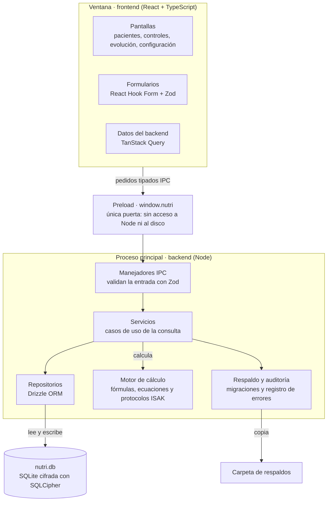

# Plan v1 — Sistema de consultas de nutrición

Actualizado: 8 de octubre de 2026

La primera versión es una aplicación de escritorio local, para un profesional, que registra pacientes y controles, calcula el gasto energético por día de la semana con fórmula configurable y muestra la evolución de la composición corporal entre controles. Se construye en seis fases, cada una con algo usable al terminar. Corre en Windows 10 y 11, la usa un solo profesional, y las fórmulas de cálculo y los protocolos de medición ISAK se incorporan uno a uno durante el desarrollo.

## Alcance de la v1

La v1 cubre el ciclo completo de una consulta: ficha, rutina, alimentación, mediciones, cálculo y gráficos. Todo lo demás se agrega sobre esa base.

| Entra en la v1 | Queda para versiones siguientes |
| --- | --- |
| Ficha del paciente con perfil (niño, adulto, adulto mayor, deportista, profesional) | Generación de pautas y minutas de alimentación |
| Rutina semanal con actividades y MET, gasto por día | Base de composición de alimentos con cálculo de macro y micronutrientes |
| Historial de controles: cada consulta se guarda completa y fechada | Portal o app para que el paciente registre desde su casa |
| Fórmula de gasto energético elegible por configuración | Varios profesionales, sincronización en la nube, agenda de horas |
| Antropometría (peso, talla, pliegues, perímetros) y composición corporal | Importación desde bioimpedanciómetros y balanzas |
| Dashboard de evolución por paciente | Informe en PDF para entregar al paciente |
| Registro de alimentación: comidas, horarios, porciones, agua | Curvas de crecimiento OMS completas para pediatría |
| Respaldo y restauración de la base de datos |  |

El sistema apoya la decisión del profesional y no la reemplaza: todo valor calculado puede ajustarse a mano y queda registrado quién lo cambió y cuándo.

## Módulos

Son seis módulos; el detalle de campos y pantallas de cada uno está en el canvas de funciones que acompaña este plan.

| Módulo | Qué hace | Dato clave que produce |
| --- | --- | --- |
| 1. Pacientes | Ficha, perfil, antecedentes, objetivo, búsqueda y listado | Edad, sexo, perfil y disciplina que alimentan las fórmulas |
| 2. Rutina diaria | Plantilla de 24 horas por cada día de la semana, con actividades tomadas de una tabla MET | Gasto energético por día (kcal) y promedio semanal |
| 3. Controles | Una ficha por consulta: mediciones, notas, cálculos congelados | Historial completo y comparable |
| 4. Antropometría | Peso, talla, pliegues, perímetros, diámetros; calcula IMC, % grasa, masa adiposa y muscular | Composición corporal de cada control |
| 5. Alimentación | Recordatorio de 24 horas y frecuencia de consumo: qué, a qué hora, porciones, agua | Patrón de comidas, hidratación y variedad |
| 6. Dashboard | Gráficos de evolución entre controles y comparación gasto versus ingesta | Lectura visual del avance del paciente |

A estos se suma una pantalla de Configuración: fórmula de gasto por defecto, ecuación de composición corporal, edición de la tabla MET, grupos de alimentos y respaldos.

## Cálculo del gasto energético

El gasto se calcula en dos pasos: una fórmula de gasto basal elegida por el profesional y la suma de las actividades del día ponderadas por su MET. Es el motor del sistema y conviene construirlo y probarlo aislado antes que las pantallas.

**Paso 1: gasto basal (TMB), con fórmula configurable.** Se define una fórmula por defecto en Configuración y se puede cambiar por paciente o por control. Las fórmulas de la tabla son candidatas: se incorporan una a una durante el desarrollo, partiendo por la que el profesional defina primero.

| Fórmula | Datos que usa | Dónde calza mejor |
| --- | --- | --- |
| Mifflin-St Jeor | Peso, talla, edad, sexo | Adultos en general |
| Harris-Benedict (revisada) | Peso, talla, edad, sexo | Adultos; la más usada históricamente |
| FAO/OMS/UNU (Schofield) | Peso, sexo y tramo de edad | Niños, adolescentes y adultos mayores |
| Katch-McArdle | Masa libre de grasa | Deportistas con composición corporal medida |
| Cunningham | Masa libre de grasa | Deportistas de alto rendimiento |

Cada fórmula declara qué datos necesita: si falta la masa libre de grasa, Katch-McArdle y Cunningham aparecen deshabilitadas en vez de calcular mal.

**Paso 2: gasto del día por MET.** El día se describe como una lista de actividades con duración que suman 24 horas (sueño, trabajo, estudio, traslados, entrenamiento, ocio). Cada actividad toma su MET de la tabla.

```latex
GET_{dia} = \sum_{i} MET_i \times peso_{kg} \times horas_i
```

Ese es el método estándar, que asume 1 kcal por kg por hora en reposo. El segundo modo reemplaza ese supuesto por el basal del paciente según la fórmula elegida, y es el que hace que cambiar de fórmula cambie el resultado:

```latex
GET_{dia} = \frac{TMB}{24} \times \sum_{i} MET_i \times horas_i
```

El modo también es una opción de Configuración. Las horas sin asignar se completan con un MET de reposo configurable, para que el día siempre cierre en 24 horas.

**Por día de la semana.** Se guarda una plantilla por cada día, de lunes a domingo, con opción de copiar un día a otros. El resultado es una tabla de siete valores en kcal más el promedio semanal, que distingue días de entrenamiento, de trabajo y de descanso.

**Tablas MET.** La base inicial es el Compendio de Actividades Físicas para adultos. Niños y adultos mayores tienen compendios propios con valores distintos, así que la tabla lleva una columna de población y el sistema filtra según el perfil del paciente. El profesional puede agregar o corregir actividades.

Cada control guarda una copia del cálculo con la fórmula, el modo y los MET usados ese día. Si después se cambia la configuración, los controles antiguos no se alteran.

## Arquitectura del sistema

El sistema es una aplicación Electron para Windows escrita completa en TypeScript. El frontend (React) corre en la ventana; el backend corre en el proceso principal de Electron, en el mismo computador, y es el único que toca la base de datos. Se comunican por un canal interno tipado (IPC), sin servidor web ni internet.



Cada pedido baja por las mismas capas: pantalla, preload, manejador, servicio y repositorio. El motor de cálculo queda aparte para probarlo solo y reutilizarlo.

### Frontend

La interfaz es una aplicación React de una sola ventana. No guarda datos: pide y envía todo al backend por el canal tipado, y valida cada formulario con los mismos esquemas que usa el backend.

| Pieza | Tecnología | Uso |
| --- | --- | --- |
| Base | React 18 + TypeScript, compilado con Vite (electron-vite) | Componentes y recarga rápida en desarrollo |
| Componentes de interfaz | Mantine | Formularios, tablas, pestañas, selector de fechas y avisos |
| Navegación | React Router | Rutas por paciente y por control |
| Datos del backend | TanStack Query | Caché, recarga después de guardar y estados de carga |
| Formularios | React Hook Form + Zod | Validación en vivo con los esquemas compartidos |
| Tablas | TanStack Table | Listado de pacientes, tabla MET, historial de controles |
| Gráficos | Apache ECharts | Evolución entre controles, gasto semanal, composición corporal |

| Ruta | Pantalla |
| --- | --- |
| `/desbloqueo` | Contraseña para abrir la base de datos |
| `/pacientes` | Listado con búsqueda y filtros por perfil |
| `/pacientes/:id` | Ficha, resumen y línea de tiempo de controles |
| `/pacientes/:id/controles/:controlId` | Control en pestañas: Rutina, Alimentación, Mediciones, Resultados, Notas |
| `/pacientes/:id/evolucion` | Dashboard del paciente |
| `/configuracion` | Fórmulas, protocolos, tabla MET, grupos de alimentos, respaldo y contraseña |

El código se ordena por módulo funcional (pacientes, controles, rutina, antropometria, alimentacion, evolucion, configuracion), cada uno con sus pantallas, componentes y llamadas al backend. La pantalla de rutina usa el motor de cálculo directamente para mostrar el gasto mientras se edita; al guardar, el backend recalcula y su resultado es el que queda en el control.

### Backend

El backend vive en el proceso principal de Electron y se ordena en capas donde cada una solo llama a la de abajo. Así la lógica clínica queda separada de la base de datos y de la interfaz.

| Capa | Responsabilidad | Ejemplo |
| --- | --- | --- |
| Manejadores IPC | Reciben cada pedido del frontend, validan la entrada con Zod y devuelven el resultado o un error legible | `controles.crear` |
| Servicios | Casos de uso: crear un control copiando el anterior, calcular y congelar resultados, respaldar | `ControlesService.crearDesdeAnterior` |
| Motor de cálculo | Fórmulas, ecuaciones y protocolos como funciones puras, sin acceso a datos | `calcularGastoSemanal` |
| Repositorios | Lectura y escritura de tablas con Drizzle ORM | `ControlesRepo.insertar` |
| Base de datos | SQLite cifrada con SQLCipher (better-sqlite3-multiple-ciphers), un solo archivo local | `nutri.db` |

Servicios transversales:

- **Migraciones:** drizzle-kit genera un script por cada cambio de esquema; al abrir la aplicación se aplican los pendientes, después de un respaldo automático.
- **Auditoría:** cada cambio a una ficha o a un valor calculado se guarda con fecha, campo, valor anterior y valor nuevo.
- **Respaldo:** copia en caliente con la API de respaldo de SQLite, al cerrar la aplicación y a pedido, en la carpeta que elija el profesional; guarda un número configurable de copias.
- **Registro de errores:** electron-log escribe en la carpeta de la aplicación para diagnosticar fallas.

El esquema incluye una tabla de profesional con un solo registro. En la v1 no controla permisos, pero evita migrar todos los datos cuando se sumen más profesionales.

### Motor de cálculo y catálogos

El motor es un paquete propio, sin dependencias de Electron ni de la base de datos, con tres catálogos que crecen durante el desarrollo: fórmulas de gasto basal, ecuaciones de composición corporal y protocolos de medición. La v1 arranca con la estructura y la primera entrada de cada catálogo; el profesional entrega las siguientes a medida que avanza el proyecto.

Cada entrada declara lo mismo. Ejemplo para una fórmula de gasto basal:

```ts
interface FormulaGastoBasal {
  id: string;             // 'mifflin-st-jeor'
  version: number;        // sube si cambia un coeficiente
  nombre: string;
  poblacion: { edadMin?: number; edadMax?: number; perfiles: Perfil[] };
  requiere: Array<'peso' | 'talla' | 'edad' | 'sexo' | 'masaLibreGrasa'>;
  fuente: string;         // referencia bibliográfica
  calcular(entrada: EntradaGasto): number; // kcal/día
}
```

Los protocolos ISAK siguen la misma idea. Un protocolo (por ejemplo, un perfil restringido o uno completo) lista sus sitios con tipo y unidad (pliegues, perímetros, diámetros, longitudes), cuántas tomas se hacen por sitio, la diferencia máxima aceptada entre tomas y cómo se obtiene el valor final. La pantalla de mediciones se arma a partir de esa definición, así que un protocolo nuevo no requiere programar pantallas.

Incorporar una fórmula, ecuación o protocolo sigue siempre los mismos pasos:

1. El profesional entrega la definición y su fuente.
2. Se escribe el módulo en el catálogo correspondiente.
3. Se agregan casos de prueba con resultados calculados a mano por el profesional; sin ellos no entra.
4. Se publica una versión nueva y la entrada aparece disponible en Configuración.

Cada control guarda el id y la versión de lo que usó. Un control antiguo siempre se puede explicar y recalcular igual que el día de la consulta.

### Contrato entre frontend y backend

El frontend solo ve un objeto `window.nutri` que expone el script de preload; no tiene acceso a Node ni al disco. Cada canal tiene un esquema Zod de entrada y de salida en el paquete compartido de contratos, así que un campo cambiado se detecta al compilar en ambos lados.

| Canal | Entrada | Devuelve |
| --- | --- | --- |
| `sesion.desbloquear` | Contraseña | Estado de la base (abierta, migrada) |
| `pacientes.listar` | Búsqueda, perfil, orden | Lista resumida |
| `pacientes.guardar` | Ficha del paciente | Paciente con id |
| `controles.crear` | Paciente, fecha, copiar del anterior | Control nuevo precargado |
| `controles.obtener` | Id del control | Control con rutina, mediciones, alimentación y resultados |
| `rutina.guardar` | Control, bloques de los siete días | Gasto por día y promedio semanal |
| `mediciones.guardar` | Control, protocolo, tomas por sitio | Valores finales y composición corporal |
| `alimentacion.guardar` | Control, comidas, agua | Porciones por grupo y variedad |
| `evolucion.series` | Paciente, variables, rango de fechas | Series para los gráficos |
| `catalogos.listar` | Tipo de catálogo | Fórmulas, protocolos, MET o grupos de alimentos |
| `configuracion.guardar` | Preferencias | Configuración vigente |
| `respaldo.crear` / `respaldo.restaurar` | Carpeta o archivo | Resultado y ruta del respaldo |

La ventana se crea con `contextIsolation` activado, `nodeIntegration` desactivado y `sandbox`, la configuración de seguridad que recomienda Electron.

### Estructura del proyecto

Un solo repositorio con pnpm workspaces separa la aplicación del motor y de los contratos, para que ambos se prueben solos y se puedan reutilizar.

```text
sistema-nutri/
├─ apps/
│  └─ escritorio/
│     ├─ src/main/            # backend: arranque, ipc/, servicios/, repositorios/, db/
│     │  └─ db/migraciones/   # scripts generados por drizzle-kit
│     ├─ src/preload/         # puente tipado window.nutri
│     └─ src/renderer/        # frontend React: modulos/, componentes/, rutas
├─ packages/
│  ├─ calculo/                # motor: formulas/, composicion/, protocolos/, met/ + pruebas
│  └─ contratos/              # esquemas Zod y tipos compartidos
├─ datos-semilla/             # tabla MET inicial y grupos de alimentos
└─ electron-builder.yml       # configuración del instalador para Windows
```

Pruebas: Vitest para el motor y los servicios, con los casos del profesional como pruebas obligatorias; Playwright para recorridos completos sobre la aplicación Electron, como crear un paciente, registrar un control y ver su evolución.

### Windows: instalación, datos y seguridad

| Tema | Decisión |
| --- | --- |
| Versiones | Windows 10 y 11 de 64 bits |
| Instalador | electron-builder con instalador NSIS; acceso directo en el escritorio y en el menú Inicio |
| Actualizaciones | En la v1 se instala la versión nueva encima de la anterior; electron-updater queda preparado para actualizar solo más adelante |
| Ubicación de datos | Base y registros en `%APPDATA%\SistemaNutri`; respaldos en la carpeta que elija el profesional |
| Cifrado | La base se cifra con una clave aleatoria, protegida por la contraseña y por una clave de recuperación impresa |
| Recordar sesión | Opcional, con `safeStorage` de Electron, que en Windows usa DPAPI y liga la clave a la cuenta de Windows del profesional |
| Bloqueo | La aplicación se bloquea tras un tiempo de inactividad configurable |
| Firma del instalador | Sin firma, Windows SmartScreen advierte la primera vez; aceptable en un solo equipo, necesaria si se distribuye |

Sin la contraseña ni la clave de recuperación los datos no se pueden leer, por diseño. La clave de recuperación se genera al instalar y el profesional la guarda impresa.

## Modelo de datos

El centro del modelo es el control: cada consulta es un registro fechado del que cuelgan mediciones, rutina, alimentación y resultados. Nada se sobrescribe; un cambio del paciente es un control nuevo.

| Tabla | Columnas principales | Relación |
| --- | --- | --- |
| `profesional` | nombre, registro profesional | Un solo registro en la v1 |
| `paciente` | rut, nombres, fecha_nacimiento, sexo, perfil, disciplina, antecedentes, objetivo, consentimiento | Tiene muchos controles |
| `control` | paciente_id, fecha, motivo, notas, formula_id, formula_version, modo_met | Pertenece a un paciente |
| `rutina_bloque` | control_id, dia_semana, actividad_id, inicio, duracion_min | Bloques de los siete días; se copian del control anterior |
| `actividad_met` | nombre, categoria, met, poblacion, fuente | Catálogo editable |
| `medicion` | control_id, protocolo_id, protocolo_version, peso_kg, talla_cm | Una por control |
| `medicion_sitio` | medicion_id, sitio_id, toma_1, toma_2, toma_3, valor_final | Una fila por sitio medido |
| `resultado` | control_id, tmb, gasto por día, promedio semanal, composición corporal, ecuacion_id, ecuacion_version | Calculado y congelado al guardar |
| `comida` | control_id, hora, tipo, alimento, grupo_id, porciones | Varias por control |
| `hidratacion` | control_id, agua_ml, otros_liquidos_ml | Una por control |
| `grupo_alimento` | nombre, porcion_referencia | Catálogo editable |
| `configuracion` | clave, valor | Preferencias del profesional |
| `auditoria` | fecha, tabla, registro_id, campo, valor_anterior, valor_nuevo | Historial de cambios |

Las mediciones se guardan sitio por sitio, con el id y la versión del protocolo. Por eso un protocolo ISAK nuevo, o un sitio agregado a uno existente, no exige cambiar las tablas. Las variables propias de un perfil (percentiles en niños, fuerza de agarre en adultos mayores) entran como sitios de un protocolo para ese perfil.

## Fases de construcción

Son seis fases y unas 14 a 18 semanas para una persona dedicada medio tiempo; la duración es una estimación que depende de quién programe. El profesional de nutrición valida al cierre de cada fase con pacientes reales o de prueba.

| Fase | Qué se construye | Entregable usable | Semanas |
| --- | --- | --- | --- |
| 0. Definición | Campos de la ficha, primera fórmula de gasto, primer protocolo ISAK, tabla MET inicial, bocetos de pantallas | Especificación validada por el profesional | 1 |
| 1. Base técnica y pacientes | Repositorio, Electron con React, puente IPC tipado, base cifrada, migraciones, desbloqueo, ficha y listado de pacientes, respaldo, instalador para Windows | Se instala en el computador de la consulta y registra pacientes | 3 |
| 2. Motor de gasto | Catálogo de fórmulas con la primera fórmula, tabla MET, rutina semanal, cálculo por día, configuración | Gasto calórico por día de la semana | 3 |
| 3. Controles y antropometría | Ficha de control, catálogo de protocolos con el primero, mediciones por toma, composición corporal con la primera ecuación, historial | Cada consulta queda guardada y comparable | 3 a 4 |
| 4. Alimentación | Recordatorio de 24 horas, frecuencia de consumo, agua, variedad por grupos | Registro alimentario por control | 2 a 3 |
| 5. Dashboard y cierre | Gráficos de evolución, comparación entre controles, pruebas con casos reales, ajustes del instalador | Versión 1 en uso diario | 3 |
| Continua | Nuevas fórmulas, ecuaciones y protocolos ISAK, cada uno con sus casos de prueba | Se suman sin detener las fases | Desde la fase 2 |

El instalador se arma desde la fase 1 para probar desde el comienzo en el Windows real de la consulta.

El orden pone el motor de gasto antes que la antropometría porque es lo más particular del sistema y lo que más ajustes va a pedir. El dashboard va al final porque necesita que existan varios controles para mostrar algo.

Criterio para dar por cerrada la v1: el profesional atiende una consulta completa, de principio a fin, sin recurrir a planillas ni papel.

## Datos sensibles y riesgos

Los datos de salud son datos sensibles y el sistema debe tratarlos así desde la v1, más aún porque incluye niños. En Chile, la Ley 21.719 fue publicada el 13 de diciembre de 2024 con vigencia fijada para el 1 de diciembre de 2026 ([AZ](https://www.az.cl/ejecutivo-publico-nueva-ley-de-datos-personales-en-chile/)); hay un proyecto del Ejecutivo para postergarla al 1 de diciembre de 2027 ([nota](https://ecosistemastartup.com/?p=104145)), cuyo estado conviene confirmar. La ley exige consentimiento expreso para datos sensibles y obliga a informar las vulneraciones de seguridad ([Diario Financiero](https://www.df.cl/opinion/ley-de-proteccion-de-datos-y-su-impacto-en-la-prestacion-de-servicios-de)).

Medidas mínimas para la v1:

- Acceso con contraseña y base de datos cifrada en disco.
- Registro del consentimiento del paciente, o de su tutor si es menor, en la ficha.
- Respaldo automático cifrado a una carpeta que el profesional elige.
- Exportar y eliminar los datos de un paciente a pedido.

| Riesgo | Efecto | Cómo se reduce |
| --- | --- | --- |
| Fórmulas mal implementadas | Recomendaciones basadas en números erróneos | Pruebas automáticas contra casos calculados a mano por el profesional |
| Ecuaciones aplicadas a la población equivocada | % de grasa o gasto sin validez en niños o adultos mayores | Cada fórmula declara su población y el sistema avisa si no calza |
| Pérdida del archivo de datos | Se pierde el historial de todos los pacientes | Respaldo automático y prueba de restauración en la fase 1 |
| Contraseña olvidada | La base cifrada queda ilegible | Clave de recuperación impresa, generada al instalar |
| Instalador sin firma digital | Windows SmartScreen advierte al instalar | Aceptar la advertencia en el único equipo; firmar si se distribuye |
| Catálogos que llegan tarde | Una fase espera una fórmula o protocolo | Cada fase parte con una sola entrada; las demás se suman en la línea continua |
| Alcance que crece durante la v1 | La primera versión no se termina | Lista de pendientes para la v2; no se agregan módulos antes del cierre |
| Carga de datos lenta en la consulta | El profesional vuelve a la planilla | Copiar rutina y alimentación del control anterior y editar solo los cambios |

Un abogado debe revisar el consentimiento y la conservación de fichas antes de usar el sistema con pacientes reales.

## Preguntas abiertas

- [ ] ¿Quién programa el sistema? El plan asume TypeScript en frontend y backend.
- [x] ¿En qué sistema operativo trabaja el profesional? Windows.
- [x] ¿Lo usará un solo profesional o varios? Uno, por ahora.
- [ ] ¿Con qué fórmula de gasto y qué protocolo ISAK parte la fase 0? Las demás se incorporan durante el desarrollo.
- [ ] ¿Qué ecuación de composición corporal se usa primero?
- [ ] ¿El registro de alimentación de la v1 queda en porciones por grupo de alimento, o se necesita desde ya el cálculo de calorías y macronutrientes?
- [ ] ¿Se usan equipos como bioimpedanciómetro cuyos datos haya que ingresar?
